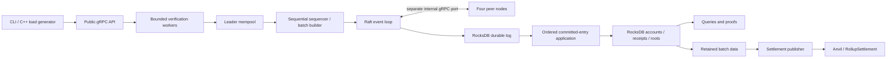

# Architecture and trust boundaries

## Status and scope

This is the target design, written before implementation. Implementation status
is tracked separately in IMPLEMENTATION_PLAN.md. The first milestone establishes
real gRPC communication between five processes. It does not elect a pretend leader
or return successful transaction responses before consensus exists.

The current standalone ledger uses a development-only manifest and aggregate state
record. Its implementation and verification status are in [persistence.md](persistence.md).
The namespaces and Raft interfaces below remain the target cluster architecture.
An isolated [Raft core](raft-core.md) now tests protocol decisions and signed
command ordering in simulation. Its persistent store, network driver, and durable
application bridge are not integrated with the running node.

The initial ledger supports fixed-width unsigned integer value transfers on one
chain, with genesis-funded accounts. There is no EVM, gas, dynamic membership,
deposit bridge, withdrawal bridge, or economic security mechanism initially.

## Components

Each process owns exactly one RocksDB directory. Public API, internal protocol,
and HTTP health/Prometheus listeners use separate ports. The static cluster
manifest contains a cluster ID and ordered member IDs/endpoints. A node must
refuse to reuse a directory for another identity or topology. Genesis and chain
identity become part of that manifest in Phase 2; the schema version must change
when the persistent format changes.

## Concurrency and ownership

* gRPC handler threads decode size-limited requests and pass bounded work to the
  owner of the relevant state. Each outbound call has a deadline.
* Signature workers perform only immutable checks: canonical decoding, chain ID,
  signature, identity. They never change balances or assign ordering.
* One sequencer owns ordered pending transactions. A deterministic overlay based
  on the applied state validates nonce and balance dependencies within a proposed
  batch. Only a current leader with recent quorum contact accepts new proposals.
* One Raft event loop owns term, role, timers, log indices, and peer progress.
  Durable storage effects complete before dependent responses are emitted.
  Asynchronous replies carry request term/generation and cannot mutate a newer
  leadership generation.
* One application worker executes committed entries strictly in index order.
  Each batch reads consistent state, constructs one RocksDB WriteBatch, and
  synchronously commits accounts, receipts, metadata, roots, and applied index.
* Read paths use RocksDB snapshots. Initial follower queries are explicitly local
  and possibly stale, tagged with applied index. Linearizable reads require the
  future ReadIndex/quorum barrier and are not implied by a leader redirect.

Queues, request bytes, batch size, RPC deadlines, and peer concurrency have hard
bounds. Shutdown stops admissions, cancels work, joins threads, and closes storage
after its users. Unexpected durable-storage errors fail the node closed.

## Submission and commitment

1. The client signs the canonical payload; tx ID is its canonical hash.
2. Followers return a leader hint, or unavailable if no leader is known.
3. The leader verifies immutable fields in parallel, then nonce/balance in order.
4. Exact retries return an existing receipt or pending handle. ID/content mismatch
   is rejected. Pending deduplication is an optimization; durable IDs are authority.
5. At the batch limit (initially 100) or timeout, one ordered entry is proposed.
6. A majority durably replicates it. Only the Raft commit rule advances commit index.
7. Replicas independently execute the committed bytes. A receipt is confirmed only
   after synchronous application succeeds. Admission is never confirmation.
8. The publisher submits the durable commitment and available transaction data to
   L1. L2 commitment and L1 finalization are distinct receipt properties.

Retries after a timeout use the same ID: a timed-out RPC may still commit. A leader
change drops its uncommitted mempool; clients retry. Execution defensively rechecks
committed input; deterministic rejection receipts must not mutate account state.
The exact rejection policy and commitment encoding must be frozen with Phase 2
golden vectors before log replication is implemented.

## Persistence and recovery

Namespaced keys in one DB keep consensus and ledger changes atomic where needed:

| Namespace | Data |
| --- | --- |
| meta/ | format, node/cluster/topology identity, genesis hash |
| raft/ | term, vote, commit index, snapshot boundary |
| log/<u64 big-endian> | term and canonical entry bytes |
| account/<20 bytes> | balance and nonce |
| receipt/<32 bytes> | ID, result, batch and log index |
| batch/<u64 big-endian> | transaction bytes, roots, proofs/trace metadata |
| ledger/ | applied index and current state root |

WAL remains enabled; correctness-critical writes use sync=true. A committed-index
write preceding application may survive alone. On restart validate
snapshot_index <= applied_index <= commit_index <= last_log_index, then replay
commit_index - applied_index entries. Application and its marker share one atomic
write, so a crash cannot persist account changes without the matching progress.
Snapshot publication/installation needs a staged, checksummed generation and an
atomic durable pointer; compaction may follow only after installation is durable.
See consensus.md for the mandatory fault cases.

## Commitments and settlement

Keccak-256 is Ethereum Keccak, not FIPS SHA3-256. All encodings are fixed and
domain-separated. Transactions use binary Merkle trees; account commitments use
a fixed-index tree over an initially bounded genesis registry. This enables a
fully verifiable, bounded single-transfer fraud proof before generalizing to
execution traces. See transaction-model.md and fraud-proofs.md.

Batch bytes, registry/genesis, and authenticated witness material are retained
through the challenge window plus a recovery margin. Raft log compaction does not
delete data-availability records. L1 commitments alone do not provide DA.

## Trust and deployment assumptions

* Five statically configured non-malicious nodes, at most two crash failures, and
  eventual communication among a majority. Arbitrarily delayed/reordered messages
  cannot break safety; partitions can stop progress.
* Durable disks honor fsync; permanent loss of a quorum's disks is not recoverable
  by this protocol. No Byzantine consensus or Byzantine storage guarantees.
* Local initial networking is plaintext and unauthenticated, restricted to loopback
  host bindings/private Compose networks. Cluster identity checks prevent accidental
  mixing, not spoofing. Internet exposure requires TLS/mTLS, auth, and rate limits.
* Account private keys remain client-side. Static genesis distributes test funds.
* Settlement initially trusts a configured publisher for availability but verifies
  supported challenges. An honest observer must have data and submit a challenge
  before expiry. Bonds, censorship resistance, L1 reorg handling, forced inclusion,
  exits, and bridge security are outside the first prototype.
* Timing goals are hypotheses. Same-machine containers are not independent failure
  domains and cannot substantiate multi-machine performance or availability claims.

## Technical risks and release gates

| Risk | Mitigation and required evidence |
| --- | --- |
| Vote acknowledged before durability | kill after every storage effect; never grant two votes in one term |
| Old leader / late replies | term-stamped events, check-quorum, stale-message partition tests |
| Duplicate or partial application | synchronous atomic WriteBatch and restart at every crash hook |
| Protobuf serialization ambiguity | separate canonical signed encoding, shared golden vectors |
| Integer overflow and self-transfers | explicit arithmetic checks and conservation/property tests |
| Invalid Keccak / malleable ECDSA | Ethereum vectors, low-s rule, cross-language signature vectors |
| Unsound fraud witness | authenticated pre-state and computed replacement root; Foundry negative tests |
| Compaction deletes recovery or DA | durable generation switch; separate DA retention |
| Unbounded queues / shutdown races | hard bounds, deadline tests, ASan/UBSan and TSan jobs |
| Misleading benchmarks | durable receipt timing, failures included, raw configuration and results |

Protocol references: [Raft extended paper](https://raft.github.io/raft.pdf),
[gRPC C++](https://grpc.io/docs/languages/cpp/basics/), and
[RocksDB operations](https://github.com/facebook/rocksdb/wiki/Basic-Operations).
